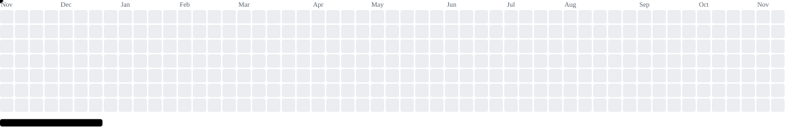

## ･°˖✧◝ About Me ◜✧˖°.

I help companies trust their own data and turn it into decisions that grow the business. I've worked in Digital Analytics for 8+ years, from event tracking to executive dashboards. My work sits at the bridge between Product, Growth, Engineering and Business, combining Product Analytics, Business Intelligence and applied AI. Today I lead data governance and measurement frameworks for marketing and growth: I define what to measure, run tracking QA and validation in Google Tag Manager, and integrate multiple sources so Product and Tech work from a single source of truth.  Built end-to-end tracking for the WhatsApp funnel, giving Product, Sales and Marketing a 360° customer view. It became a case study in Google's official newsletter. Led the Universal Analytics → GA4 migration with no measurement downtime and full governance throughout the transition. Led the Innovation & Applied AI Squad: set the AI roadmap, validated PoCs, trained cross-functional teams and brought automation and AI-first workflows into daily operations.  Using this GitHub to document my studies and analytics projects

## ･°˖✧◝ Socials ◜✧˖°.

## ･°˖✧◝ Tech Stack ◜✧˖°.

                        

## ･°˖✧◝ Contributions ◜✧˖°.

<picture data-importer="pacman"> <source media="(prefers-color-scheme: dark)" srcset="https://raw.githubusercontent.com/jmartellet/jmartellet/pacman-output/breakout-contribution-graph-dark.svg?game=breakout"> <source media="(prefers-color-scheme: light)" srcset="https://raw.githubusercontent.com/jmartellet/jmartellet/pacman-output/breakout-contribution-graph.svg?game=breakout">  </picture>

## ･°˖✧◝ Projects ◜✧˖°.

**[AI Opportunity Prioritizer](https://github.com/jmartellet/prioritizer-framework)** ✧ Framework para priorizar iniciativas de IA em 5 dimensões, com score ponderado, radar de valor, exportação para Jira e parecer estratégico com Gemini.

**[Web Analytics Tagging Plan](https://github.com/jmartellet/web-analytics-tagging-plan)** ✧ Ferramenta aberta para especificar eventos de Web Analytics antes do desenvolvimento. Quem pede a mensuração preenche o contexto da iniciativa, os prints das telas, os eventos e os parâmetros, e a ferramenta gera o documento para o time de desenvolvimento, o código sugerido (dataLayer, gtag ou Adobe) e os critérios de aceite para QA.

**[Gameplay Studies](https://github.com/jmartellet/gameplay-studies)** ✧ Estudos e projetos práticos sobre o universo gamer e de livestream: as dores reais de streamers e comunidades, transformadas em ferramentas.

## ･°˖✧◝ On Repeat ◜✧˖°.

(◡◕⏖◕)ᑐ🝐 ⠁⭒*.✩.*⭒⠁
